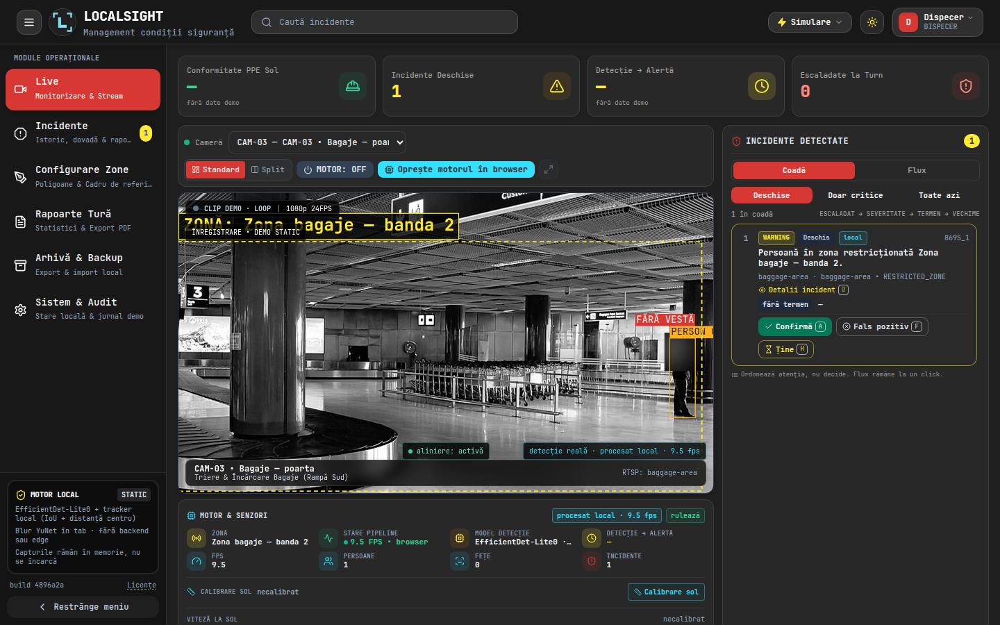
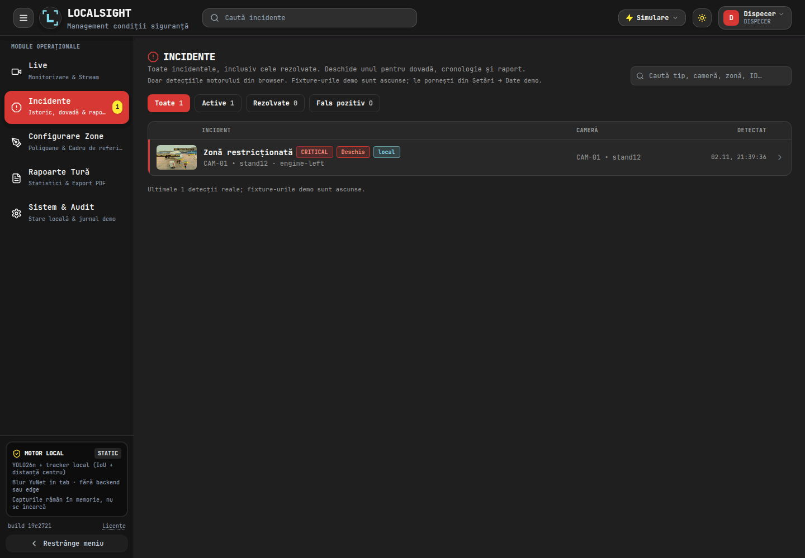
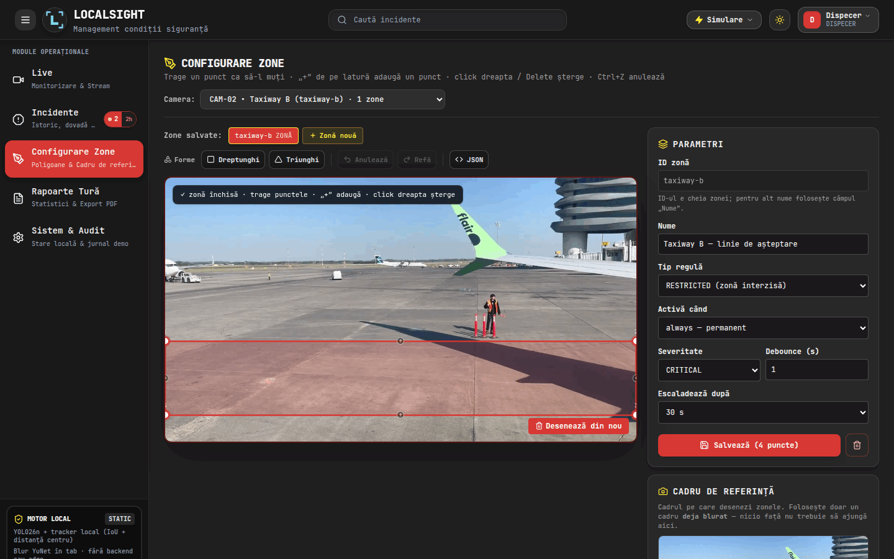

# LocalSight

Pipeline-ul de siguranță de pe platformă, mutat în browser: detecția persoanelor, zonele,
regulile, blur-ul pe fețe și incidentele rulează într-un singur tab, fără server, iar
cadrele nu pleacă pe rețea. LocalSight este forkul proiectului SafeSight, construit la un
hackathon: în loc de un edge box care trimite evenimente unui backend, tot traseul devine
cod de frontend.

Linkul public este un **showcase static** — UI-ul React rulează pe date mock
(`VITE_USE_MOCK=true`), dar poate rula și motorul real pe clipul demo sau pe camera
browserului. Motorul e scris în [`frontend/src/engine/`](frontend/src/engine/): YOLO26n +
YuNet + tracker + zone + reguli + blur + vestă hi-vis. Pe browsere fără WebGPU (inclusiv
Firefox, intenționat) pornește doar la cerere, pe WASM; un service worker aduce anteturile
COOP/COEP, deci rulează pe 4 thread-uri (`~5–6 fps` cu cadrul procesat la 1280).
Fork-ul nu mai conține stack-ul Python de referință: `backend/`, `ml/` și `automation/` au
fost șterse din acest repo, iar tot ce livrează produsul e în `frontend/`. Codul Python
vechi rămâne disponibil în istoricul git și în repo-ul upstream SafeSight.

Demo static: <https://andreisugu.github.io/LocalSight/>

## Stare

| Ce | Stare | Unde se vede |
|---|---|---|
| UI React + Vite pe date mock | funcționează | [`frontend/`](frontend/), linkul de sus |
| Showcase static cu clipurile demo | funcționează, fără backend | linkul de sus |
| Build și deploy static (GitHub Pages) | funcționează, doar după un CI verde pe `main` (`workflow_run`) | [`.github/workflows/pages.yml`](.github/workflows/pages.yml) |
| Identificarea build-ului live | footer-ul sidebar-ului: `build <sha>` (sau `build dev` local) | [`Sidebar.jsx`](frontend/src/components/layout/Sidebar.jsx) |
| Modele ONNX servite din repo | funcționează | [`frontend/public/models/`](frontend/public/models/) (9,9 MB + 232 KB) |
| Motor browser: YOLO + YuNet + tracker + zone + evenimente | funcționează în Live, `/lab` și `/bench` | [`frontend/src/engine/`](frontend/src/engine/) |
| WASM pe 4 fire pe Pages | funcționează prin service worker COOP/COEP, fără cache | [`frontend/public/coi-serviceworker.js`](frontend/public/coi-serviceworker.js) |
| Raport de tură | calculat din incidentele vizibile, marcat `șablon` | `/reports` |
| Detecție de vestă hi-vis (PPE) | funcționează; badge `VESTĂ` / `FĂRĂ VESTĂ` / `PPE ?` pe canvas | [`frontend/src/engine/vest.js`](frontend/src/engine/vest.js); `NO_PPE` cere un om de ≥150 px în cadru |
| Camere | 3 clipuri demo + camera browser (getUserMedia) | selectorul de cameră din Live |
| Blur pe fețe înainte de desenare | funcționează pe cadrul din canvas și în snapshot | `worker.js`; JPEG 960 px, fețele blurate, URL deținut de pagină |
| Motor browser în Live | opt-in, ~1,8–3 fps pe WASM | comutatorul „Procesează în browser” |
| Backend, Slack, MJPEG, SQLite | în afara scopului | stack-ul Python a fost scos din acest fork; vezi istoricul git |

Cifrele de browser sunt măsurate pe hardware-ul de dezvoltare, pe clipul de 1080p:
**5,2–6,0 fps** în Chromium și **5,2 fps** în Firefox, pe WASM cu 4 fire și cadrul
procesat la 1280 px. Fără cap, la 1920×1080, aceleași fire dau ~3,7 fps. Firele vin din
`frontend/public/coi-serviceworker.js`: un service worker care re-servește navigările cu
COOP/COEP (GitHub Pages nu poate trimite antete custom), fără să cacheze nimic. Fără el
(dev, browser fără service worker) motorul cade pe un singur fir: 1,5–1,8 fps. Firefox este
ținut intenționat pe WASM — WebGPU în workeri dădea 0,4–0,7 fps și putea bloca sesiunea ONNX
Runtime. Chrome/Edge folosesc WebGPU când există adapter; cifra depinde de GPU. Sub 2 fps,
panoul din Live avertizează după 10 s de rulare.

Teste: 422 Node (`node --test`, motor, utilitare, date, servicii, componente și raport), 5 E2E Playwright la baza
`/` și 5 E2E pe forma de deploy (`/LocalSight/`, COI + motor pornit); CI rulează unit,
build-ul de frontend, ambele suite e2e și o gardă pentru subpath-ul de Pages. Comenzile
canonice sunt în [`RUNNING.md`](RUNNING.md#teste).

## Pagini

Toate rutele sunt client-side, definite în `VIEW_PATHS` din
[`frontend/src/context/SecurityContext.jsx`](frontend/src/context/SecurityContext.jsx).

| Rută | Ce face |
|---|---|
| `/` | Live: 3 clipuri demo sau camera locală, panoul de incidente și comutatorul „Procesează în browser” |
| `/incidents` | lista de incidente, cu severitate, status și dovadă |
| `/zones` | editorul de zone, poligon desenat pe cadrul de referință |
| `/reports` | raportul de tură: KPI și rezumat |
| `/lab` | motorul pe un clip ales sau pe webcam: fps, persoane, fețe, incidente |
| `/bench` | fps/p50/p95 pe provider și mărime de intrare, istoric în `localStorage` |

## Capturi


*Live: feed-ul camerei CAM-01 cu zona motorului și incidentele detectate.*


*Incidente: lista completă, cu severitate, status și dovada foto.*


*Configurare zone: poligonul pe canvas și parametrii regulii.*

## Pornire rapidă

Pornirea canonică — dezvoltare, build static, teste și deploy — stă în
[`RUNNING.md`](RUNNING.md#pornire-rapidă); nu duplic comenzile aici. Ai nevoie de Node 20+;
build-ul mock nu are nevoie de niciun server, iar modelele sunt servite din `dist/models/`.

Regulile de lucru pentru autori sunt în [`AGENTS.md`](AGENTS.md); ghidul de contribuție, în
[`CONTRIBUTING.md`](CONTRIBUTING.md).

## Arhitectură

Tot pipeline-ul rulează în tab: camera → detecție → tracking → reguli de zonă → blur →
eveniment → UI React. Nu există proces de server, nici coadă, nici bază de date. Cifrele
măsurate în browser sunt în [`docs/browser-engine.md`](docs/browser-engine.md); cele ale
vechii referințe CPU, în [`docs/performance.md`](docs/performance.md) (istoric).

Traseul, așa cum e scris azi:

```text
<video> (clip în buclă sau getUserMedia)
   └─ ImageBitmap ─► Web Worker: ONNX Runtime Web (WebGPU, fallback WASM)
                        YOLO → YuNet → tracker → vestă → zone/reguli
                        → blur (fețe + banda capului) → eveniment
                     ├─ cadru adnotat (ImageBitmap) ─► canvas 2D
                     └─ evenimente în memorie ─► UI React
```

Nimic nu urcă pe rețea: se descarcă doar fișierele statice (JS, `yolo26n.onnx`,
`yunet.onnx`, clipul). Starea trăiește în tab și se pierde la reload. Deciziile, inclusiv
cum se obțin firele WASM pe un host fără antete custom, sunt în
[`docs/browser-engine.md`](docs/browser-engine.md).

## Harta repo-ului

| Folder | Rol |
|---|---|
| [`frontend/`](frontend/) | produsul: UI React + Vite, motorul din browser, modelele statice, build-ul de Pages |
| [`docs/`](docs/) | contract, nota motorului de browser, media, rapoarte QA/arhitectură/ops și documente istorice marcate |
| [`scripts/`](scripts/) | pregătirea clipurilor și raportul de proveniență |
| [`data/`](data/) | README-urile de proveniență ale clipurilor și adnotărilor; fișierele mari nu sunt în git |
| [`demo/`](demo/) | scenariul demo-ului curent și run sheet-urile istorice |

Modelele se regenerează cu [`frontend/scripts/prepare-models.py`](frontend/scripts/prepare-models.py)
(sursele au fost în stack-ul Python șters; vezi istoricul git), iar clipurile web cu
[`scripts/prepare-demo-media.sh`](scripts/prepare-demo-media.sh). Comenzile exacte și
avertismentele sunt în [`RUNNING.md`](RUNNING.md#modele-și-media) și
[`docs/media.md`](docs/media.md).

## Ce e real, ce e demo

| Real, în tab | Demo / fixture |
|---|---|
| YOLO26n + YuNet + tracker + zone + reguli | KPI-urile din strip și incidentele fără chip `local` |
| Blur pe fețe înainte de desenare, fail-closed | Raportul de incident (șablon, nu LLM) |
| Detecția de vestă hi-vis și starea PPE | Escaladarea din fixture-uri |
| Incidentele motorului, marcate `local`, cu dovada procesată | Camera locală (flux propriu, doar cu permisiune) |

Scenariul de prezentare, pas cu pas: [`demo/run_sheet_browser.md`](demo/run_sheet_browser.md).

## Licență

**Business Source License 1.1**, textul integral în [`LICENSE`](LICENSE).

- copiere, modificare și uz neproductiv: permise;
- uz în producție, inclusiv găzduire sau încorporare într-un serviciu: necesită licență
  comercială de la Licensor;
- la **2 noiembrie 2030** licența devine Apache 2.0.

## Third-party

- **Ultralytics YOLO este AGPL-3.0.** `yolo26n.onnx` din repo provine din greutățile
  Ultralytics, iar build-ul static îl distribuie ca fișier descărcabil. Un produs
  proprietar sau găzduit are nevoie de licență enterprise Ultralytics ori de conformare
  AGPL pe tot ansamblul. BSL-ul acestui repo nu schimbă asta.
- **YuNet este MIT** (OpenCV Zoo); se redistribuie cu nota de copyright.
- **Clipurile demo**: sursele 4K din `data/videos/` nu sunt în git; versiunile web din
  `frontend/public/media/` sunt comise (excepție țintită în `.gitignore`) și nu fac parte
  din opera licențiată.
- **Capturile demo** din `frontend/public/media/stills/`: Unsplash (apron), CC BY-SA 2.0
  © Derek Harper (taxiway), CC0 (bagaj); cele trei `zone-*.jpg` sunt cadre din clipurile
  demo, cu aceeași proveniență necompletată. Detalii în [`THIRD_PARTY.md`](THIRD_PARTY.md).
- **Notificări în artefact:** build-ul publică [`frontend/public/NOTICE`](frontend/public/NOTICE)
  ca `dist/NOTICE`, linkat din footer-ul sidebar-ului („Licențe”); conține nota AGPL-3.0
  Ultralytics, copyright-ul MIT YuNet și trimiterea la `THIRD_PARTY.md`.

## Proveniență

Istoricul git al fork-ului păstrează toată istoria SafeSight; nimic nu a fost squash-uit.
Ce cod a rămas de la fiecare autor se măsoară pe linii cu
`python3 scripts/provenance.py` (`git blame -w`), iar `--audit <fișier>` listează exact
liniile rămase. Standardul de „înlocuit" — implementare nouă, logică testată, nu doar clase
schimbate — și lista a ce s-a amânat sunt în
[`docs/rewrite-backlog.md`](docs/rewrite-backlog.md); raportul generat este
[`docs/provenance.md`](docs/provenance.md). La 2 noiembrie 2026: **97,0%** din liniile de
cod de produs sunt ale noastre, **3,0%** sunt schelet JSX/etichete/valori de design, iar
auditul nu mai găsește **nicio linie de logică** moștenită. Stack-ul Python a fost scos din
fork; rămâne în istoricul git și în upstream.

## Credite

Proiectul a fost construit la un hackathon ca **SafeSight**, de Andrei, Max, Dalina și
Ariana; documentele și run sheet-urile păstrează numele celor care le-au scris. Acest fork
păstrează pipeline-ul prin portarea lui în browser și scoate din produs backend-ul,
alertarea și raportarea; stack-ul Python de referință nu mai face parte din repo.
