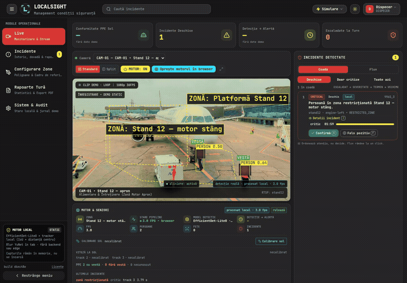
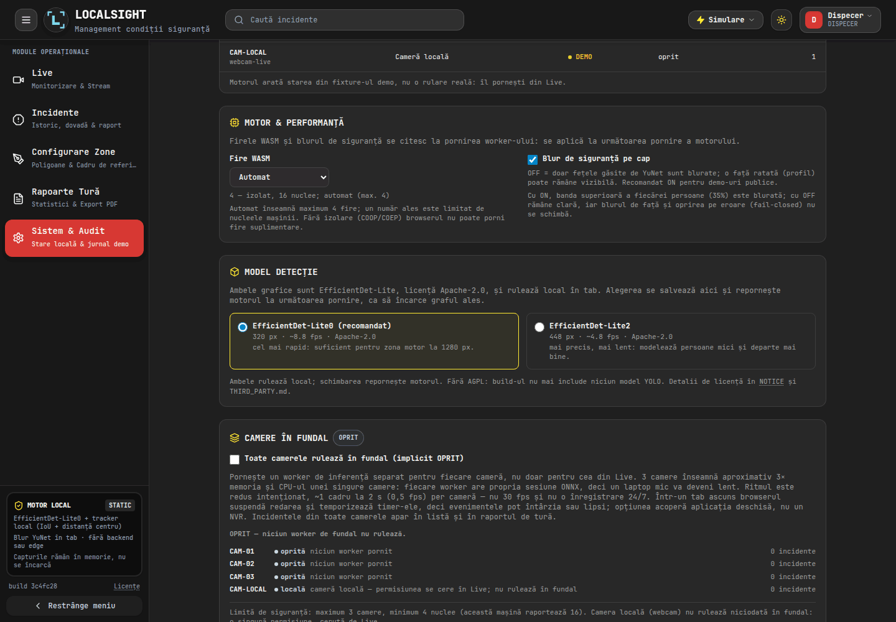
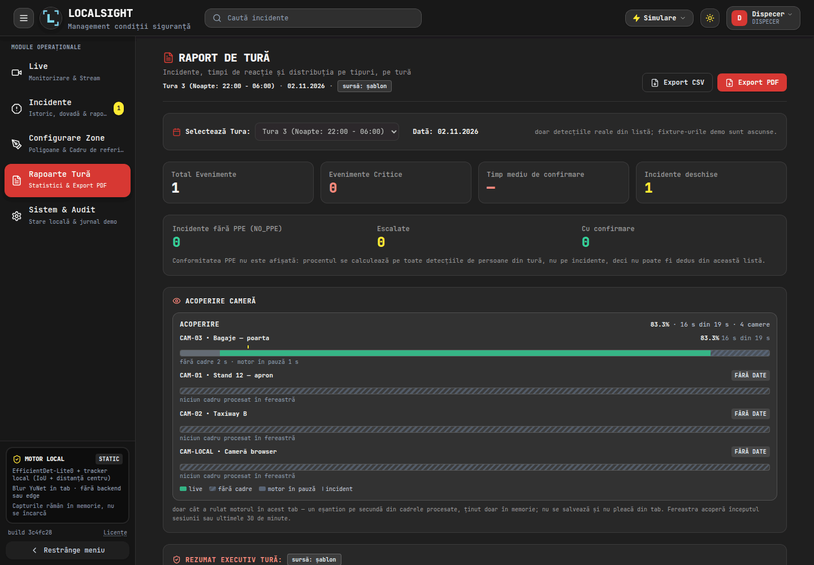
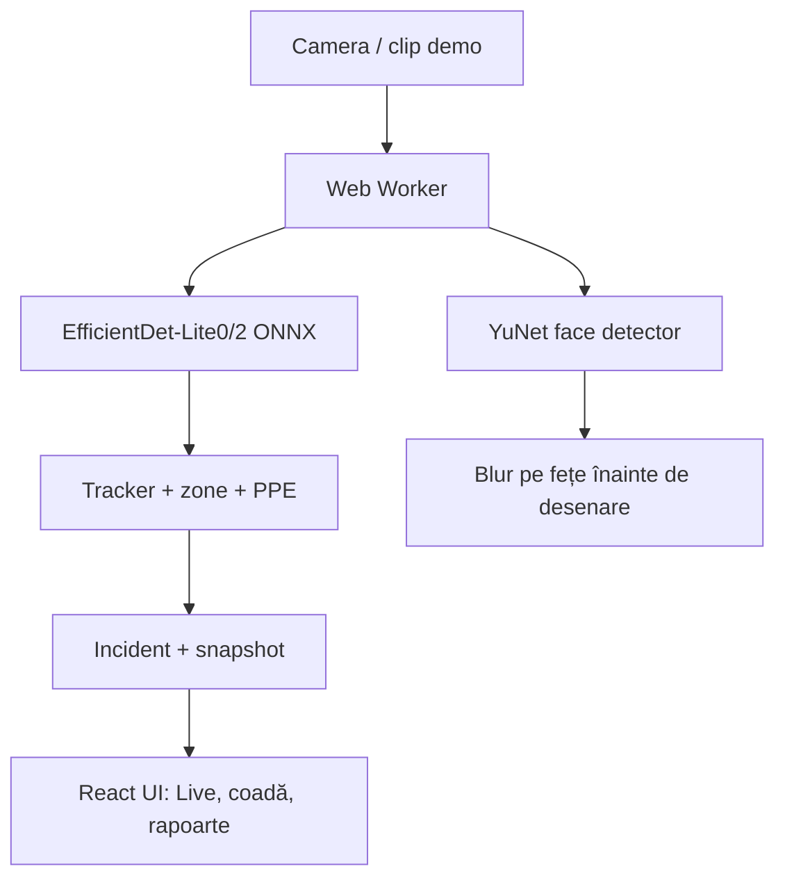

# LocalSight

**Airport apron safety in a browser tab.** EfficientDet-Lite0/Lite2 person detection, YuNet face blur, zones, PPE, triage and incident reports — all local, no server, no frame leaving the tab.

[Build public](https://andreisugu.github.io/LocalSight/) · [Documentație](docs/README.md) · [Proveniența modelului](docs/legal/model-provenance.md)

LocalSight duce pipeline-ul de siguranță al proiectului SafeSight în browser: în loc de un
edge box care trimite evenimente unui backend, tot traseul devine cod de frontend. Pipeline-ul — detecție, tracking, zone, reguli, blur pe fețe, PPE, incidente —
rulează într-un singur tab, iar cadrele nu pleacă pe rețea.

Linkul public este un **build static**: UI-ul React rulează pe date mock
(`VITE_USE_MOCK=true`) și poate porni motorul real pe clipurile demo sau pe camera
browserului. YOLO26n (AGPL-3.0) a fost scos din build; detectorul implicit este
**EfficientDet-Lite0** (Apache-2.0), cu **EfficientDet-Lite2** ca opțiune mai precisă din
Setări.

## Model

| | EfficientDet-Lite0 (implicit) | EfficientDet-Lite2 (opțiune) |
|---|---|---|
| Input | 320×320 | 448×448 |
| FPS pe hardware-ul de dezvoltare, 4 fire WASM, cadru 1280 | **~8,8** | **~4,8** |
| COCO mAP | 25,7 | 34,0 |
| ONNX | 13,8 MB | 22,9 MB |
| Licență weights | Apache-2.0 | Apache-2.0 |

Acuratețea nu e maximă; am ales licența permissivă și fluiditatea. Lite2 recuperează o
parte din recall, cu ~45% mai lent. Cifrele sunt măsurate pe hardware-ul de dezvoltare;
pe un laptop mic scad. Detaliile și lanțul de licențe: [`docs/legal/model-provenance.md`](docs/legal/model-provenance.md).

## Stare

| Ce | Stare | Unde se vede |
|---|---|---|
| UI React + Vite pe date mock | funcționează | [`frontend/`](frontend/), linkul de sus |
| Build static cu clipurile demo | funcționează, fără backend; clipurile sunt generate din still-uri Unsplash/CC0 | linkul de sus |
| Build și deploy static (GitHub Pages) | funcționează, doar după un CI verde pe `main` (`workflow_run`) | [`.github/workflows/pages.yml`](.github/workflows/pages.yml) |
| Identificarea build-ului live | footer-ul sidebar-ului: `build <sha>` (sau `build dev` local) | [`Sidebar.jsx`](frontend/src/components/layout/Sidebar.jsx) |
| Model detecție | EfficientDet-Lite0 implicit; Lite2 din Setări; ambele Apache-2.0 | [`frontend/public/models/`](frontend/public/models/), [`SettingsView.jsx`](frontend/src/components/views/SettingsView.jsx) |
| Motor browser: detector + YuNet + tracker + zone + evenimente | funcționează în Live, `/lab` și `/bench` | [`frontend/src/engine/`](frontend/src/engine/) |
| WASM pe 4 fire pe Pages | funcționează prin service worker COOP/COEP, cu cache versionat pe build | [`frontend/public/coi-serviceworker.js`](frontend/public/coi-serviceworker.js) |
| Raport de tură | calculat din incidentele vizibile, marcat `șablon` | `/reports` |
| Detecție de vestă hi-vis (PPE) | funcționează; badge `VESTĂ` / `FĂRĂ VESTĂ` / `PPE ?` pe canvas | [`frontend/src/engine/vest.js`](frontend/src/engine/vest.js); `NO_PPE` cere un om de ≥150 px în cadru |
| Camere | 3 clipuri demo generate din still-uri licențiate + camera browser (getUserMedia) | selectorul de cameră din Live |
| Blur pe fețe înainte de desenare | funcționează pe cadrul din canvas și în snapshot | `worker.js`; JPEG 960 px, fețele blurate, URL deținut de pagină |
| Backend, Slack, MJPEG, SQLite | în afara scopului | stack-ul Python a fost scos din acest fork; vezi istoricul git |

Cifrele de browser sunt măsurate pe hardware-ul de dezvoltare, pe clipul de 1080p:
**8,8 fps** cu Lite0 și **4,8 fps** cu Lite2 în Chromium, pe WASM cu 4 fire și cadrul
procesat la 1280 px. Fără cap, la 1920×1080, aceleași fire sunt mai lente. Firele vin din
`frontend/public/coi-serviceworker.js`: un service worker care re-servește navigările cu
COOP/COEP (GitHub Pages nu poate trimite antete custom) și ține un cache versionat pe SHA-ul
build-ului: HTML-ul rămâne network-first, iar fișierele imuabile (assets hash-uite, modele,
clipuri, still-uri) sunt cache-first. Un deploy nou activează alt worker și șterge cache-ul
vechi. Fără el (dev, browser fără service worker) motorul cade pe un singur fir.

Teste: **741 Node** (`node --test`, motor, utilitare, date, servicii, componente și raport),
5 E2E Playwright la baza `/`, 6 E2E pe forma de deploy (`/LocalSight/`, COI + motor pornit,
plus cardul de model) și 3 E2E de persistență; CI rulează unit, build-ul de frontend, ambele suite e2e și o gardă
pentru subpath-ul de Pages. Comenzile canonice sunt în [`RUNNING.md`](RUNNING.md#teste).

## Pagini

Toate rutele sunt client-side, definite în `VIEW_PATHS` din
[`frontend/src/utils/appRoute.js`](frontend/src/utils/appRoute.js).

| Rută | Ce face |
|---|---|
| `/` | Live: 3 clipuri demo sau camera locală, motorul în browser, coada de triaj (Coadă/Flux) și feed-ul de incidente |
| `/incidents` | lista de incidente, cu severitate, status și dovadă |
| `/zones` | editorul de zone, poligon desenat pe cadrul de referință |
| `/reports` | raportul de tură: KPI, rezumat și acoperirea camerei din sesiune |
| `/settings` | Sistem & Audit: model detecție, thread-uri WASM, blur, camere în fundal, date demo |
| `/lab` | motorul pe un clip ales sau pe webcam: fps, persoane, fețe, incidente |
| `/bench` | fps/p50/p95 pe provider și mărime de intrare, istoric în `localStorage` |

## Capturi

*Live: motorul din browser pe CAM-03 (clip demo generat din still licențiat), zona restricționată, coada de triaj și un incident real; fixture-urile demo sunt oprite.*

*Setări: EfficientDet-Lite0 implicit, Lite2 pentru acuratețe; ambele Apache-2.0, fără AGPL.*

*Incidente: doar detecția reală de pe clipul generat, cu severitate, status și dovadă; datele demo sunt ascunse implicit.*

*Configurare zone: poligonul pe canvas și parametrii regulii, pe cadrul de referință generat.*

*Rapoarte: acoperirea se calculează din eșantioanele motorului din acest tab — segmente live, tab ascuns și pauze; fără eșantioane afișează „fără date”.*

## Pornire rapidă

Pornirea canonică — dezvoltare, build static, teste și deploy — stă în
[`RUNNING.md`](RUNNING.md#pornire-rapidă); nu duplic comenzile aici. Ai nevoie de Node 20+;
build-ul mock nu are nevoie de niciun server, iar modelele sunt servite din `dist/models/`.

Regulile de lucru pentru autori sunt în [`AGENTS.md`](AGENTS.md); ghidul de contribuție, în
[`CONTRIBUTING.md`](CONTRIBUTING.md).

## Arhitectură

Tot pipeline-ul rulează în tab: camera → detecție → tracking → reguli de zonă → blur →
eveniment → UI React. Nu există proces de server, nici coadă, nici bază de date. Cifrele
măsurate în browser sunt în [`docs/browser-engine.md`](docs/browser-engine.md); cele ale
vechii referințe CPU, în [`docs/performance.md`](docs/performance.md) (istoric).

Nimic nu urcă pe rețea: se descarcă doar fișierele statice (JS, modelul ONNX, `yunet.onnx`,
clipul). Starea trăiește în tab și se pierde la reload. Deciziile, inclusiv cum se obțin
firele WASM pe un host fără antete custom, sunt în
[`docs/browser-engine.md`](docs/browser-engine.md).

## Ce e real, ce e demo

| Real, în tab | Demo / fixture |
|---|---|
| EfficientDet-Lite0/Lite2 + YuNet + tracker + zone + reguli | Incidentele din fixtures și KPI-urile derivate din ele — **ascunse implicit**, se activează din Setări → Date demo |
| Blur pe fețe înainte de desenare, fail-closed | Raportul de incident (șablon, nu LLM) |
| Detecția de vestă hi-vis și starea PPE | Escaladarea din fixture-uri |
| Coada de triaj: deadline, episoade, hold doar pe WARNING | Pragurile și starea vin din evenimentele reale; acțiunile trăiesc în memorie |
| Calibrarea solului și viteza per track | Viteza e indicatorie, pe cadrul de referință; fără calibrare scrie „necalibrat” |
| Acoperirea camerei din eșantioanele sesiunii | Doar cât a rulat motorul în tab; nu se salvează și nu pleacă din browser |
| Incidentele motorului, marcate `local`, cu dovada procesată | Camera locală (flux propriu, doar cu permisiune) |

Scenariul de prezentare, pas cu pas: [`demo/run_sheet_browser.md`](demo/run_sheet_browser.md).

## Licențe

| Componentă | Licență | Notă |
|---|---|---|
| Codul LocalSight | **BSL 1.1** | uz neproductiv liber; producție/găzduire cu licență comercială; Apache 2.0 din 2030-11-02 |
| EfficientDet-Lite0/Lite2 (weights) | **Apache 2.0** | © Google; uz comercial cu notice |
| Conversia ONNX | **CC BY 3.0** | Namas Bhandari; atribuire obligatorie |
| YuNet | MIT | © Shiqi Yu / OpenCV Zoo |
| ONNX Runtime Web | MIT | © Microsoft |
| Runtime JS/WASM: React, lucide, protobuf, flatbuffers | MIT / ISC / BSD-3 / Apache-2.0 | texte complete în [`frontend/public/LICENSES.txt`](frontend/public/LICENSES.txt) |
| Still-uri stock: apron / baggage | Unsplash / CC0 | atribuite în [`frontend/public/NOTICE`](frontend/public/NOTICE); clipurile demo sunt derivate din ele |
| Contribuții upstream | **cod: 100% al nostru** | ultimele 535 de linii au fost rescrise pe 3 nov; docs/design rămân creditate |
| Clipuri demo generate + zone stills | proiect (din Unsplash/CC0) | fără footage necunoscut în build; clipurile vechi rămân doar în istoricul git |

> **Gap cunoscut:** build-ul curent nu conține AGPL și nu mai folosește clipurile vechi, dar
> blob-ul `yolo26n.onnx` și clipurile vechi rămân în istoricul git public. Un repo nou cu
> istoric filtrat/commit curat le elimină; vezi
> [`docs/legal/model-provenance.md`](docs/legal/model-provenance.md) §5.
>
> **Contribuitori:** codul curent a fost rescris integral pe 3 noiembrie; `provenance.py`
> raportează 0 linii de la colegi. Docs/design-ul rămâne creditat; pentru licențiere
> comercială, confirmă acordul pentru docs/design sau rescrie-le; template în
> [`docs/legal/contributor-assignment-template.md`](docs/legal/contributor-assignment-template.md).

Nu este consultanță juridică. Auditul complet, lanțul de proveniență, SHA-256-urile și
checklist-ul comercial sunt în [`THIRD_PARTY.md`](THIRD_PARTY.md) și
[`docs/legal/model-provenance.md`](docs/legal/model-provenance.md). Notificările servite în
build sunt în [`frontend/public/NOTICE`](frontend/public/NOTICE), linkate din footer-ul
sidebar-ului („Licențe”).

## Proveniență

Istoricul git al fork-ului păstrează toată istoria SafeSight; nimic nu a fost squash-uit.
Ce cod a rămas de la fiecare autor se măsoară pe linii cu `python3 scripts/provenance.py`
(`git blame -w`), iar `--audit <fișier>` listează exact liniile rămase. Standardul de
„înlocuit” — implementare nouă, logică testată, nu doar clase schimbate — și lista a ce s-a
amânat sunt în [`docs/rewrite-backlog.md`](docs/rewrite-backlog.md); raportul generat este
[`docs/provenance.md`](docs/provenance.md). La 3 noiembrie 2026: **100%** din liniile de cod de produs sunt ale noastre, **0%** de la
colegi, iar auditul nu mai găsește **nicio linie de logică** moștenită. Ultimele 535 de linii
de schelet JSX/importuri au fost rescrise pe 3 noiembrie. Stack-ul Python a fost scos din fork;
rămâne în istoricul git și în upstream.

## Credite

Proiectul a fost construit la un hackathon ca **SafeSight**, de Andrei, Max, Dalina și
Ariana; documentele și run sheet-urile păstrează numele celor care le-au scris. Acest fork
păstrează pipeline-ul prin portarea lui în browser și scoate din produs backend-ul,
alertarea și raportarea; stack-ul Python de referință nu mai face parte din repo.

Upstream: [`DaVecTORzzz/craiova-hack-2026`](https://github.com/DaVecTORzzz/craiova-hack-2026)
(repo public). Istoria commit-urilor este păstrată integral, iar licența BSL 1.1 și
creditele de mai sus rămân valabile dacă acest repo iese din rețeaua de fork-uri GitHub.
